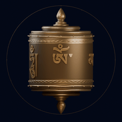

# Digital Prayer Wheel

M5Stack Dial v1.1で動く、手の回転と映像をつなぐインタラクティブ作品です。
外周リングを回すと、画面のマニ車が同じ角度だけ回ります。
チベット仏教のマニ車をモチーフとし、宗教的な功徳の再現は目的としていません。

<p align="center">
  
</p>

## 現在の機能

- **CLASSIC v0.5**：六字真言をフォントから正確に組版し、立体の金属文字として配置した32フレームの回転映像。
- **回転同期**：物理リング1周に対して画面も1周（64カウント）。正逆回転に対応し、入力が止まると本体も止まります。
- **FEVER**：起動後の累計1、3、6、10、20周で、光の尾、粒子、波紋、レベルアップ表示が増えます。
- **表示切り替え**：FEVER、QUIET、GLOW。効果は本体映像と別レイヤーで描き、停止後に減衰します。
- **短い通知音**：起動、操作確認、0時の位置で1周したときに鳴ります。ミュートに対応しています。
- **設定保存**：表示モードとミュートをNVSに保存します。ブザーBGM案は取り下げ、実装から削除しています。

CLASSICの文字の見やすさ、回転のつながり、物理1:1対応、0時の通知音は実機で確認済みです。
FEVERの派手さと最大段階での連続描画性能、長時間運転、USBバッテリーでの動作確認は残っています。
検証した範囲は[検証記録](docs/VALIDATION.md)と[公開用ログ](docs/evidence/README.md)に記載しています。

## 操作

| 操作 | 動作 |
| --- | --- |
| 外周リングを回す | マニ車を回転 |
| 画面を短くタップ | FEVER → QUIET → GLOW → FEVER |
| 画面を約700ms長押し | 設定を開く、または閉じる |
| 設定中にリングを回す | SOUNDまたはEFFECTSを選択 |
| 設定中にタップ | 選択項目を変更 |

FEVERの回転数は今回の起動中で累計し、再起動でリセットします。
回転比は確認表示のみで、設定画面から誤変更できないようにしています。

## 対応ハードウェア

M5Stack Dial v1.1（ESP32-S3、8MBフラッシュ、PSRAMなし、240×240円形LCD、エンコーダー、タッチ、内蔵ブザー）。
初期構成はUSB-C給電で、外付け部品は不要です。
ピン配置と電源の根拠は[ハードウェア資料](docs/HARDWARE.md)を参照してください。

## ビルドと書き込み

Python 3.10以上、Git、PlatformIO用のネットワーク接続を用意してください。
ホスト側のモデルテストにはC++11対応コンパイラーも必要です。

```sh
git clone https://github.com/ikkou/digital-prayer-wheel.git
cd digital-prayer-wheel
python3 -m venv .venv
. .venv/bin/activate
python -m pip install -r requirements-dev.txt
export PLATFORMIO_CORE_DIR="$PWD/.pio-core"
pio run -e m5dial_v11
```

Windowsでは仮想環境を`.venv\Scripts\Activate.ps1`で有効にし、同じ名前の環境変数を設定してください。
実機で確認した依存バージョンは`platformio.ini`に固定しています。
GC9A01の実機応答IDに対応する小さなパッチは、ビルド前にダウンロード済みM5GFXへ自動適用します。

接続ポートは`pio device list`で調べ、次の`PORT`を置き換えます。

```sh
pio run -e m5dial_v11 --target upload --upload-port PORT
python tools/flash_asset_pack.py --port PORT --package assets/classic_v05/animation.dpw
```

ファームウェアと画像パックは別々に書き込みます。
画像は専用パーティションの`0x410000`から配置し、LittleFSの`uploadfs`は使いません。
同梱のパックは3,686,674 bytesで、4,128,768-byteのアセット領域に収まります。
パーティション構成を変更する場合は、画像書き込みツールのオフセットも合わせて変更してください。

既存のモデルテストは次のコマンドで実行できます。

```sh
python tools/run_host_tests.py
```

## アセットの再生成

`assets/classic_v05/`にBlenderマスター、240×240 PNG原本32枚、RGB565パック、コンタクトシート、回転GIF、検証結果を収録しています。
既存画像を使う場合、Blenderでの再レンダリングは不要です。

新しい32枚のPNGを変換する例です。
独自素材のディレクトリを`SOURCE_DIRECTORY`へ指定してください。

```sh
python tools/import_artwork.py \
  --source-dir SOURCE_DIRECTORY --frame-count 32 --encoding rgb565 \
  --output assets/built/classic/animation.dpw \
  --contact-sheet assets/built/classic/contact_sheet.png
```

新しい画像は実機レビュー前に完成扱いにせず、`--final-artwork`を付けません。
Blenderでの再構築、文字の出典、レビュー済み画素のハッシュ照合は[刻印の制作手順](docs/INSCRIPTION.md)にまとめています。
バイナリー仕様は[アセット仕様](docs/ASSET_SPEC.md)、各ツールの用途は[tools/README.md](tools/README.md)を参照してください。

## ソース構成

```text
src/                     Hardware / Input / RotationModel / Renderer / Effects / Audio / Settings / App
include/                 各インターフェース、描画処理、純粋な状態モデル
partitions/              8MBフラッシュの領域定義
tests/host/              実機を使わず実行できるモデルテスト
tools/                   Blender生成、文字組版、画像変換、書き込み、プレビュー
assets/classic_v05/      現行マスター、原本フレーム、配布パック、検証結果
assets/lettering/        Unicode原文、字形アウトライン、同梱フォントとライセンス
assets/diagnostics/fever/ FEVERのコードから生成した比較画像とGIF
docs/                    設計資料、制作手順、検証記録
```

描画方式を差し替える入口は`IFrameAssetSource`です。
回転角からフレームを選ぶ処理、回転数の段階判定、残光描画はそれぞれ分離しています。
資料全体の入口は[docs/README.md](docs/README.md)です。

## ライセンス

プロジェクト全体の再利用ライセンスは未指定です。
同梱のNoto Serif TibetanはSIL OFL 1.1に従います。
依存関係とフォントの権利表記は[THIRD_PARTY_NOTICES.md](THIRD_PARTY_NOTICES.md)を参照してください。
